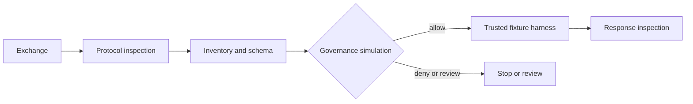

# mcpOps

**Connect intelligence. Control capabilities.**

Offline-first Model Context Protocol (MCP) inspection, governance and testing toolkit.

  [](https://github.com/ops-universe/mcpOps/actions/workflows/ci.yml)

> Development source repository. Public release is deferred. See [implementation status](docs/status/IMPLEMENTATION-STATUS.md) for scoped evidence and limitations.

## Why mcpOps?

Inspect protocol exchanges and tool permissions before connecting tools to an agent. Make supported protocol boundaries and authorization explicit.

## Features

- Pinned legacy and modern request/complete-response inspection subsets.
- Explicit inventory registry, bounded closed-world schemas and trusted-root persistence.
- Default-deny governance, scoped simulated approvals and heuristic security inspection/redaction.
- Deterministic mock harness, CLI and dashboard with explicit snapshot import/export.
- Scoped pinned SDK 2.4.0 synthetic in-process HTTP discovery/list/call interoperability.

## Architecture



[Architecture](docs/architecture/overview.md) · [Harness](docs/architecture/harness.md) · [Registry](docs/architecture/registry.md) · [SDK](docs/architecture/sdk.md)

## Quickstart

Requires Node.js 22+ and npm. Work from the repository root; the package is private and not presented as an npm release.

```sh
git clone https://github.com/ops-universe/mcpOps.git
cd mcpOps
npm ci
npm test
npm run demo
```

## CLI and examples

Use synthetic fixtures only.

```sh
npm run demo
node src/cli.mjs tool < examples/tool.json
```

## Configuration

The CLI accepts bounded JSON via stdin for `request`, `tool`, `inventory`, `governance`, `security`, `redact`, `test`, `legacy-transcript`, `permissions`, `configuration`, `modern-request` and `response`. Use an explicit trusted directory for local registry commands. See [protocol scope](docs/architecture/protocol-research.md), [local governance](docs/architecture/local-governance.md) and [SDK scope](docs/architecture/sdk.md).

## Scope and limitations

Not full MCP conformance or arbitrary server execution. SDK evidence covers pinned 2.4.0 and a fixed synthetic in-process HTTP exchange only; no external network or third-party interoperability claim. Approvals are simulation-only, permissions declarative and security findings heuristic. Trusted local account and directory required.

Read the [threat model](docs/security/threat-model.md) before integrating with real data or systems.

## Roadmap

See [ROADMAP.md](ROADMAP.md) and [implementation status](docs/status/IMPLEMENTATION-STATUS.md). Developer Preview launch and public release remain deferred.

## Contributing and support

Read [CONTRIBUTING.md](CONTRIBUTING.md), [Code of Conduct](CODE_OF_CONDUCT.md), and [SECURITY.md](SECURITY.md). Open a focused [issue](https://github.com/ops-universe/mcpOps/issues) with a minimal synthetic reproduction or documentation proposal. Run `npm ci` and `npm test` before opening a focused PR. Report security concerns using the security policy rather than public issues.

## Related projects

[evalOps](https://github.com/ops-universe/evalOps) · [guardOps](https://github.com/ops-universe/guardOps) · [ragOps](https://github.com/ops-universe/ragOps) · [traceOps](https://github.com/ops-universe/traceOps) · [workflowOps](https://github.com/ops-universe/workflowOps) · [dataOps](https://github.com/ops-universe/dataOps) · [Ops Universe](https://github.com/ops-universe)

## License

[MIT](LICENSE)
